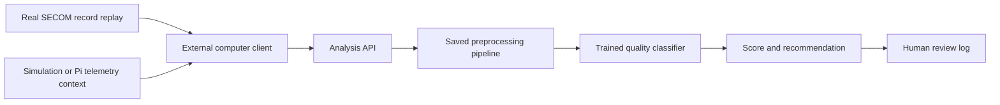

# AI integration without RAG

The project now has an actual trained machine-learning model and an analysis API.
There is no document retrieval, vector database, embedding pipeline, RAG, or LLM call.
The numerical predictor is supervised logistic regression. Explanations are application
templates plus numerical feature contributions, not generated text from a language model.

The confirmed robot is a Raspberry Pi 5 with 4 GB RAM. Hardware movement and CPU
monitoring stay on the Pi; training and this AI service stay on the Mac/external host.
See [PHYSICAL_DESIGN.md](</Users/joshua/Desktop/ai-based wafer/PHYSICAL_DESIGN.md>) for
the carrier/station design, Pi adapter, calibration and physical test sequence.

## What is implemented

1. Download real SECOM manufacturing records from Kaggle.
2. Fit missing-value handling, feature filtering, scaling, and a supervised classifier.
3. Evaluate on a later chronological test partition.
4. Serve the saved preprocessing/model pipeline through an authenticated API.
5. Return a process-quality alert, supporting model contributions, and a recommendation.
6. Store the recommendation for a human to approve or reject.

The real-dataset model is connected to the external-computer API. Simulation context
such as CPU temperature and queue length can accompany a record, but it is not falsely
treated as SECOM model input. Approval records a human decision only; it does not dispatch
a robot command. The synthetic transport simulator remains a separate scheduling baseline.

## Dataset and provenance

- **Downloaded dataset:** [Kaggle UCI SECOM](https://www.kaggle.com/datasets/paresh2047/uci-semcom),
  dataset identifier `paresh2047/uci-semcom`.
- **Local CSV:** `data/datasets/secom/uci-secom.csv`.
- **Actual downloaded shape:** 1,567 rows; 590 measurement columns (`0` through `589`),
  one timestamp column and one `Pass/Fail` label column.
- **Labels:** 1,463 pass records (`-1`) and 104 fail records (`1`). The model encodes failure as 1.
- **Original source:** [UCI SECOM](https://archive.ics.uci.edu/dataset/179/secom).
- **Original attribution:** McCann, M. & Johnston, A. (2008). SECOM. DOI: 10.24432/C54305.
  UCI lists the original dataset under CC BY 4.0.
- `download_source.json` and the model metadata retain source URLs and file checksums.

This is actual public manufacturing data, not robot logs or Raspberry Pi temperature data.
Its anonymous feature columns do not identify physical sensor meanings. A SECOM record
cannot be replaced by a CPU temperature or inferred from a mock robot camera.

## Training and measured evaluation

Records are sorted chronologically, keeping identical timestamps together:

| Partition | Records | Purpose |
| --- | ---: | --- |
| Training | 940 | Fit all preprocessing and classifier parameters |
| Validation | 313 | Select regularization strength and the alert threshold |
| Test | 314 | Final evaluation after selection |

Pipeline: median imputation and missingness indicators → constant-feature removal →
selection of 40 features → standardization → class-weighted logistic regression.
Three regularization values are compared on validation average precision. The alert
threshold maximizes validation F2, prioritizing recall. Test labels are never model inputs.
The saved model is trained on the training partition only; validation is not used to refit it.

**Current test results are weak and must be reported honestly:** of 12 failed test records,
the model flagged 2 and missed 10. It also flagged 44 passing records.
Failure recall is 16.7%, failure precision 4.35%, and average precision 0.066.
The always-pass baseline has average precision 0.038 and detects no failures.
Accuracy alone is misleading because passing records dominate this dataset.

The class-weighted output is an uncalibrated model score. It is not a verified probability
that a real wafer will fail. The chronological test includes only 12 failures, so the result
is uncertain. These findings establish a working integration and a benchmark to improve;
they do not establish useful fab quality control or improved robot throughput.

Full metrics, confusion counts, splits, feature choices and package versions are saved in
`data/ai/secom-v1/evaluation.md` and `model_metadata.json`.

## API flow



The same service code runs locally or inside the cloud container. Local execution has
been tested. **No remote cloud service has been deployed.** Cloud processing becomes
actual cloud processing only after this container/service is hosted on a cloud runtime
and the external client sends requests to that remote URL.

| Endpoint | Function |
| --- | --- |
| `GET /health` | Report model readiness and identity |
| `POST /ai/analyze` | Validate a 590-value record, preprocess it and run model inference |
| `GET /ai/recommendations/<id>` | Retrieve a result and human-review status |
| `POST /ai/recommendations/<id>/review` | Record approve/reject and reviewer identity |

Analysis input fields: `record_id`, `features` (590 finite numbers or null values), and
optional `context`. Allowed context includes `lot_id`, `queue_length`, and
`cpu_temperature_c` with `cpu_temperature_source` of `synthetic` or `real_sensor`.
An all-null feature vector is rejected. CPU temperature generates a separate rule-based
75°C advisory; it never enters the learned SECOM classifier.

Top feature contributions explain which standardized anonymous measurements changed the
classifier's failure score. They are associations in the model, not causal diagnoses.
Every recommendation is informational and requires human review. No API endpoint can
alter station settings, move motors, or approve itself.

## Running locally

The dataset and model are already present. To start the local API explicitly:

```bash
cd "/Users/joshua/Desktop/ai-based wafer"
.venv/bin/python -m wafer_project ai-serve
```

In a second terminal in the same directory:

```bash
.venv/bin/python -m wafer_project ai-demo
```

The demo sends a genuine held-out SECOM feature vector from `demo_input.json`, along
with explicitly synthetic CPU temperature and lot-association context. It saves the API
response to `demo_http_result.json`. It does not assert that the sampled record actually
failed, approve the recommendation, or move any robot.

The setup already ran an end-to-end HTTP demonstration using Gunicorn and the actual
saved pipeline. The response matched direct model inference, was persisted for review,
and remained `pending_review`. The temporary local server was stopped afterward.
`live_http_validation.json` records this check. Twenty offline tests passed.

For a fresh download/model directory, use explicit new output paths:

```bash
.venv/bin/python -m wafer_project ai-download --output data/datasets/secom-new
.venv/bin/python -m wafer_project ai-train --dataset data/datasets/secom-new/uci-secom.csv --output data/ai/secom-new
```

Existing datasets and nonempty model output folders are preserved. The default cloud
Dockerfile packages the `secom-v1` model; update its paths when adopting another artifact.

## Cloud-service files

- `Dockerfile.ai`: Python 3.12 image, pinned ML dependencies, saved model and Gunicorn.
- `requirements-ai-lock.txt`: exact AI-service dependency versions matching training.
- `wafer_project/ai_api.py:create_cloud_app`: production application factory.
- `AI_API_TOKEN`: required secret for network-facing service requests.
- `AI_ARTIFACT_DIR`: model directory (already set in the image).
- `AI_REVIEW_DATABASE`: SQLite path; mount persistent storage to retain review history.
- `PORT`: listening port, default 8080 in the container.

The container files are prepared but have not been built or deployed during this work.
The SQLite review store suits a single-instance prototype; replicas need a shared database.
Configure `AI_API_TOKEN` through the chosen cloud runtime's secret settings, and use an
HTTPS service URL for remote requests. The client reads the token from its environment.

## Source files

| File | Responsibility |
| --- | --- |
| `wafer_project/ai_data.py` | Public Kaggle download and provenance |
| `wafer_project/ai_training.py` | Train/validation/test separation, model fitting and evaluation |
| `wafer_project/ai_predictor.py` | Saved pipeline inference, validation and numerical contributions |
| `wafer_project/ai_api.py` | Analysis API, authentication and review persistence |
| `wafer_project/ai_client.py` | External-computer HTTP client |
| `tests/test_ai.py` | Model/API contract, authentication, review and data-split checks |
