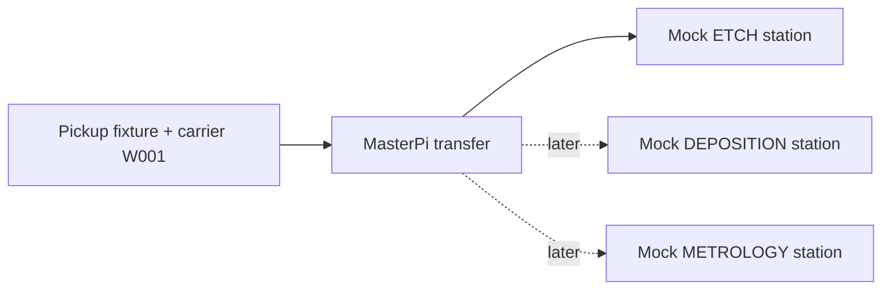

# Physical prototype: MasterPi, Raspberry Pi 5, 4 GB RAM

## What we are designing

A small wafer-lot transport demonstrator built around the robot you already own.
The design work is the carrier, station fixtures/layout, repeatable movement routines,
external software, and experiment procedure. The stations imitate manufacturing steps;
no real etching, deposition, wafer processing or cleanliness certification is involved.

The first deliverable is one repeatable **pickup → delivery → return** cycle. Additional
stations and externally selected tasks come after this transfer is reliable.

## Physical build

| Part | Practical design |
| --- | --- |
| Simulated lot | Lightweight block or small empty carrier with a label such as W001; a grip-friendly handle if needed |
| Pickup fixture | A cardboard/foam guide that holds the carrier in the same position every trial |
| First destination | One marked ETCH mock station with a repeatable drop-off fixture |
| Later destinations | DEPOSITION and METROLOGY labels/fixtures; mock processing is represented by availability state |
| Test area | Flat clear floor, taped home/stop positions and short measured routes; begin with one straight route |
| Observation | Operator records whether pickup, carrying and placement succeeded; video is optional supporting evidence |

Start with pickup and one destination roughly 0.5 m apart as a proposed bench layout;
adjust to the available area and measured robot behavior. This spacing is a design choice,
not a manufacturer accuracy or payload specification. Make fixtures suit the robot's
actual gripper reach and carrier geometry. Return the robot to the same marked home
pose for every trial.



## Which computer does what

| Pi 5 / 4 GB on the robot | Mac or externally hosted service |
| --- | --- |
| Vendor wheel/servo SDK and measured motion sequence | Scheduling, data preparation, model training and graphs |
| CPU-temperature readings | AI quality-analysis API and operator review |
| Local command cancellation and physical trial event log | Experiment summaries and comparison of control conditions |

Use the vendor image's existing hardware libraries. Do not replace its OS or install the
laptop's complete ML stack on the Pi just to move the robot. The project robot dependency
file contains Flask; basic hardware inspection and event logging use the standard library.
The project needs Python 3.10+; robot-check reports the installed version without changing it.

## Code that is now present

- `hardware/pi5_4gb.json`: confirmed model/RAM, SDK location, project motion limits and enable switch.
- `hardware/calibration.json`: pickup frames plus outbound/place/return steps for each station.
- `wafer_project/pi5_hardware.py`: read-only identity, OS-visible memory and SDK-path checks;
  also validates and previews motion plans.
- `wafer_project/pi5_driver.py`: adapter for `common.mecanum.MecanumChassis` and
  `common.ros_robot_controller_sdk.Board`, matching the current Hiwonder Pi 5 examples.
- `robot-check`, `robot-plan`, `robot-run`: explicit local commands; robot-run previews
  by default. Only `--execute` can request actual calibrated movement.
- `GET /hardware`: read-only inspection in the existing robot API.
- `data/templates/physical_observations.csv`: empty observation sheet, not sample measurements.

The vendor modules are imported only during explicit physical execution. They are not
installed on the Mac. The adapter has been tested against fake backends, not your robot.
If the vendor image places `common` in another directory, set sdk_root or the vendor's
Python environment accordingly. robot-check reports the discovered module paths.

The active profile initially has motion disabled and null calibration values. There are
no guessed pulse widths, gripping positions, route speeds or travel durations. The bounds
in the profile are starter software limits; narrow them using the actual arm calibration.

## First robot session

1. Put the carrier and the two initial fixtures in place. Mark the robot's home pose.
2. Connect to the Pi's existing desktop/terminal using the vendor setup, with the Mac
   and Pi on the local network. Copy this project to a directory on the Pi, excluding
   the Mac `.venv`, datasets, ML model files, simulation outputs and Docker files.
   Keep the `wafer_project` package, config.json, hardware directory and requirements-robot.txt.
3. In the project directory **on the Pi**, run the read-only command below. This inspects
   the confirmed hardware; you do not need to identify the model again.

   ```bash
   python3 -m wafer_project robot-check
   ```

   Expected: Pi 5 identity, approximately 4 GB nominal RAM (OS-visible RAM will be lower),
   a real CPU temperature, supported Python and both vendor module paths. The same
   command on a Mac correctly reports that it is not the target robot.
4. Use the Hiwonder examples/arm editor in supervised calibration sessions to establish
   a grip/lift/carry pose and a release/retract pose for this carrier. Close other vendor
   driving/autonomous programs before using the project runner.
5. Measure a short outbound segment and return segment from the marked home pose.
   The initial code uses bounded timed translation, with no automatic localization or
   obstacle sensing. Multiple short segments can be added. Wheel slip/pose drift must
   be measured; timing alone does not establish precision navigation.
6. Replace null values in hardware/calibration.json with the verified steps. Arm steps
   have `positions: [[servo_id, pulse], ...]` and duration_s in seconds. Translation steps
   have speed_mm_s, direction_deg and duration_s. Add as many separate calibrated
   grip/lift/retract frames as the handling sequence needs. Directions follow the vendor
   convention: forward 90°, backward 270°, right 0°, left 180°.
7. Set calibrated=true with a calibration_id identifying the carrier/layout, then enable
   motion in the hardware profile when that configuration is ready for a supervised trial.
   Confirm the destination is marked available in config.json.
8. Preview the entire transfer before any execution:

   ```bash
   python3 -m wafer_project robot-plan --lot-id W001 --destination ETCH
   ```

   The preview lists missing/invalid calibration values. No vendor library or motor command
   is executed. A valid preview still needs the actual hardware check before movement.
9. Only during that supervised robot session, the following command executes the plan:

   ```bash
   python3 -m wafer_project robot-run --lot-id W001 --destination ETCH --execute
   ```

   Do not run it from the Mac. The code verifies model/RAM/Python/SDK, rejects incomplete
   calibration, serializes project motion processes, limits each step, and sends wheel-stop
   commands between steps and on exit. Ctrl+C requests cancellation. An already issued
   short servo frame can finish; software cancellation is not a physical emergency stop.
   Keep the robot's power control accessible during physical calibration.
10. Record the actual result and repeat the same cycle about 10 times. Retain failures.

The driver writes physical-<trial_id>.json under data/logs. Its outcome is
`executed_unverified`, because successfully sending commands cannot prove that the
carrier arrived. Record observed success separately in the CSV template and match its
trial_id to the event log. Command elapsed time and independently observed delivery time
are distinct measurements; record both when available.

## Temperature monitoring

In another Pi terminal, during a later authorized physical session:

```bash
python3 -m wafer_project monitor --samples 120 --interval 5
```

This reads actual CPU/SoC temperature and writes a timestamped CSV. The default 75°C
alert is a configurable project advisory, not a manufacturer thermal limit. CPU temperature
does not measure room/wafer temperature and is not a learned SECOM model input.

## What the AI contributes

The Kaggle SECOM model examines public historical semiconductor-process measurements
and proposes operator review of quality risk. It is a separate, real-data AI demonstration
connected through the external API. Its current held-out performance is weak; see the
AI evaluation. A labeled mock carrier can be associated with a replayed SECOM record for
demonstration, but that mapping must be labeled artificial. The Pi does not provide those
590 process measurements.

AI recommendations require human review. They do not generate motor pulses, prove a
wafer is defective, or automatically authorize a transfer. No RAG is included. Cloud hosting
is prepared but has not been deployed.

The carrier-to-record mapping is in data/lot_manifest.json. W001, W002 and W003 point
to the first three chronological held-out records, selected without looking at their labels
or model scores. The mapping is marked demonstration-only and checked against the
downloaded CSV's checksum. Run these commands on the Mac:

```bash
.venv/bin/python -m wafer_project lot-payload --lot-id W001
.venv/bin/python -m wafer_project lot-analyze --lot-id W001
```

lot-payload prepares the actual 590 measurements without networking. lot-analyze sends
them to the AI service (start ai-serve first), stores its recommendation and retains the
dataset-replay provenance. Pass --url with a hosted HTTPS API URL after cloud deployment.
No ground-truth label or invented CPU value is sent. A flagged record can prompt an
operator inspection at the METROLOGY mock station before its normal process route;
that decision is manual and must not substitute an unrelated fabrication process.

For an AI model that genuinely improves this robot's handling, first collect robot-specific
camera/pose/grip/timing data with success/failure labels. The relevant learned task could
then be carrier localization or predicting a failed pickup. We must evaluate that separately
from the current SECOM classifier and scheduling-policy comparisons.

## Experiments after the first transfer works

1. **Local baseline:** fixed pickup/delivery cycle, with actual success rate and time.
2. **External control:** same physical routine selected externally; measure communication
   delay, then compare the same scheduling rule locally/externally.
3. **Scheduling disruption:** mark one destination unavailable and compare FIFO with
   available-first on the same eligible task list. This is a rule-based scheduling comparison.
4. **AI analysis/review:** replay held-out SECOM records, measure inference latency and
   classification quality, and record operator decisions. Report these as distinct results.

The remote `/transfers` endpoint remains a mock preview/logging path. Physical commands
currently run locally on the Pi. Adding remote movement requires a separate authenticated
command worker, duplicate-command protection and tested disconnect behavior; the existing
mock endpoint has not silently become a hardware controller.

## Manufacturer references

- [Pi 5 MasterPi wheel-control examples](https://docs.hiwonder.com/projects/MasterPi/en/latest/docs/6.motion_control_course.html)
- [Pi 5 board/arm API examples](https://docs.hiwonder.com/projects/MasterPi/en/latest/docs/7.basic_course_kinematics.html)
- [Vendor action editor and fixture-specific arm calibration](https://docs.hiwonder.com/projects/MasterPi/en/latest/docs/10.upper_computer_action_editing_course.html)
