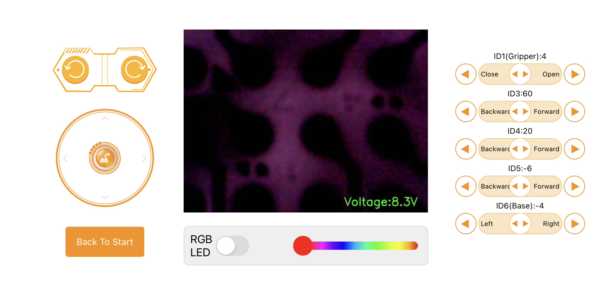
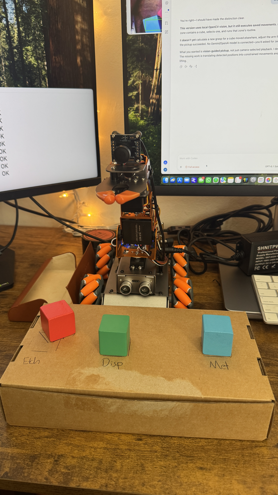
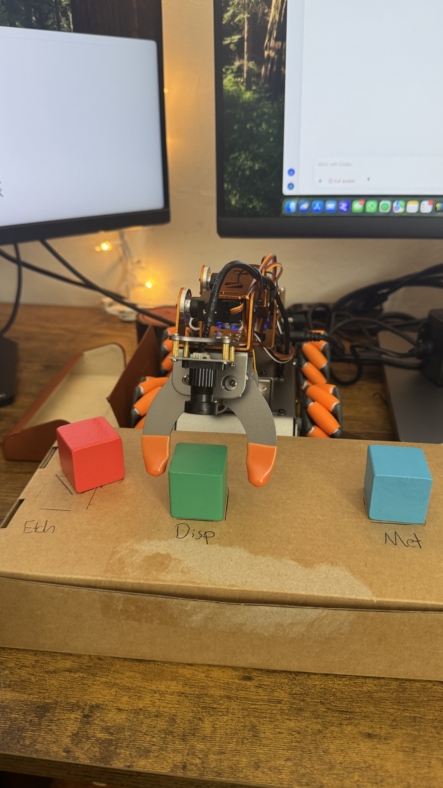
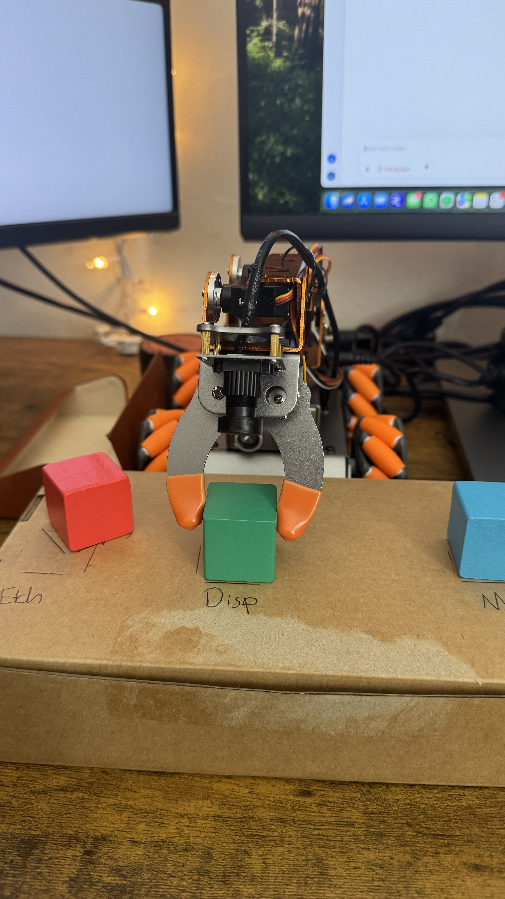
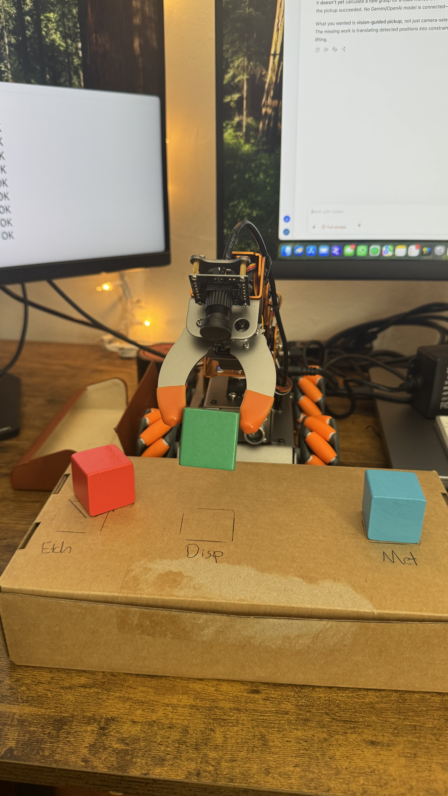
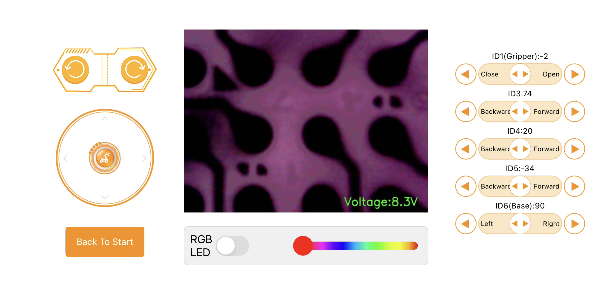
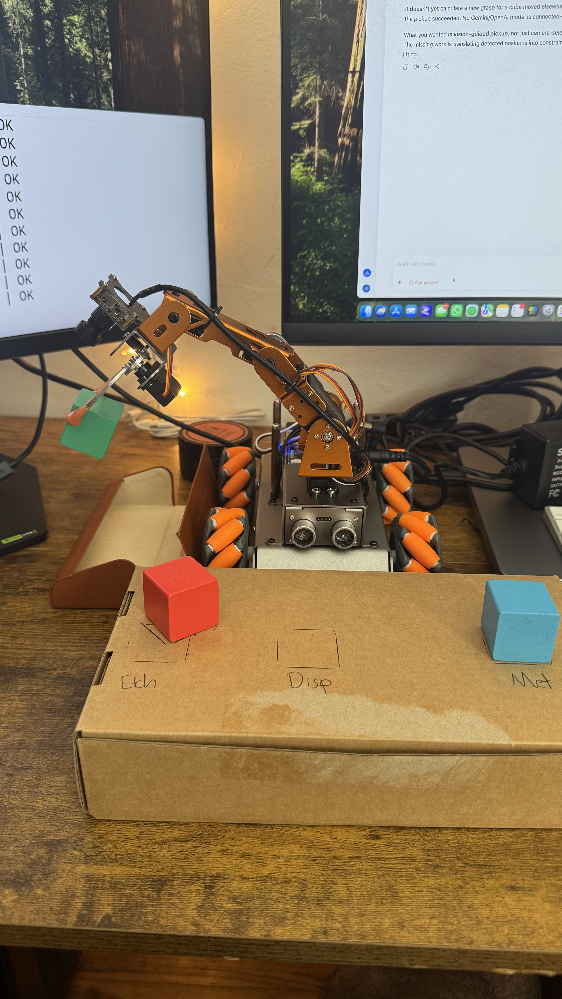
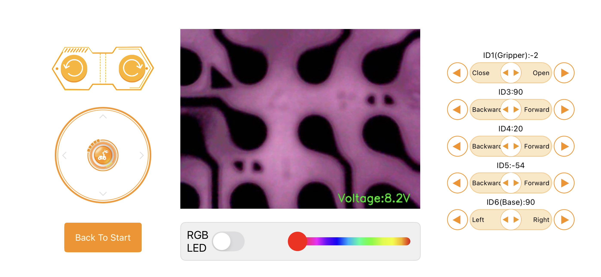
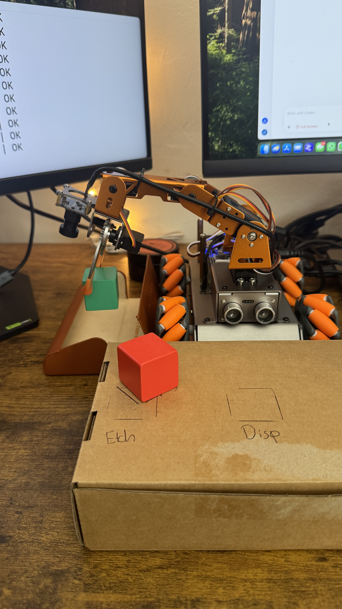
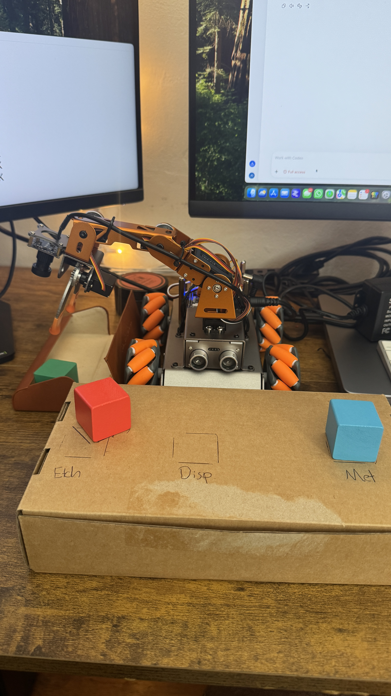

# Deposition — step-one photo and position record

This set records **green = deposition** (center, labeled `Disp`), **red = etch** (left, labeled `Etch`), and **blue/cyan = metrology** (right, labeled `Met`). This is the new pictured layout; earlier records remain historical and were not overwritten.

All 14 supplied files are sorted numerically and paired below. Original files in Downloads are unchanged. HEIC controls are converted to JPEG for viewing; robot photos are copied into this folder with ordered descriptive names. Pairing follows adjacent filenames, not independent measurement of joint angles.

## Ordered positions

| Step | Controls | Robot photo | Position | ID1 | ID3 | ID4 displayed only | ID5 | ID6 | Voltage |
| --- | --- | --- | --- | ---: | ---: | ---: | ---: | ---: | ---: |
| 1 | IMG_0992.HEIC | IMG_0993.JPG | Start/reference pose | 4 | 60 | 20 | -6 | -4 | 8.3 V |
| 2 | IMG_0994.HEIC | IMG_0995.JPG | Open approach to green cube | -30 | 74 | 20 | -56 | -4 | 8.3 V |
| 3 | IMG_0996.HEIC | IMG_0997.JPG | Grip at deposition pickup location | -2 | 74 | 20 | -56 | -4 | 8.3 V |
| 4 | IMG_0998.HEIC | IMG_0999.JPG | Lift green cube | -2 | 74 | 20 | -34 | -4 | 8.3 V |
| 5 | IMG_1001.HEIC | IMG_1002.JPG | Turn toward drop-off | -2 | 74 | 20 | -34 | 90 | 8.3 V |
| 6 | IMG_1003.HEIC | IMG_1004.JPG | Lower held cube toward tray | -2 | 90 | 20 | -54 | 90 | 8.2 V |
| 7 | IMG_1005.HEIC | IMG_1006.JPG | Release into tray | -24 | 90 | 20 | -54 | 90 | 8.3 V |

## Sequence diagram

```text
Start → Open approach → Grip → Lift → Turn to tray → Lower → Release
```

No return-to-start photo or control screenshot was supplied after release. No return movement is invented here.

## Paired visual evidence

### 01 — Start/reference pose

Arm upright; empty gripper fingers close together. Green cube rests at Disp; red at Etch and blue at Met.

Sources: [IMG_0992.HEIC](/Users/joshua/Downloads/IMG_0992.HEIC) and [IMG_0993.JPG](/Users/joshua/Downloads/IMG_0993.JPG).





### 02 — Open approach to green cube

Arm extended forward; fingers open around/above green cube, which remains on cardboard.

Sources: [IMG_0994.HEIC](/Users/joshua/Downloads/IMG_0994.HEIC) and [IMG_0995.JPG](/Users/joshua/Downloads/IMG_0995.JPG).




### 03 — Grip at deposition pickup location

Fingers sit on opposite sides of green cube. Cube is still on the surface; lift is not yet shown.

Sources: [IMG_0996.HEIC](/Users/joshua/Downloads/IMG_0996.HEIC) and [IMG_0997.JPG](/Users/joshua/Downloads/IMG_0997.JPG).




### 04 — Lift green cube

Green cube visibly held above the cardboard; Disp outline is empty.

Sources: [IMG_0998.HEIC](/Users/joshua/Downloads/IMG_0998.HEIC) and [IMG_0999.JPG](/Users/joshua/Downloads/IMG_0999.JPG).




### 05 — Turn toward drop-off

Arm and held green cube extend toward the tray at the left of the photo. Cube remains suspended.

Sources: [IMG_1001.HEIC](/Users/joshua/Downloads/IMG_1001.HEIC) and [IMG_1002.JPG](/Users/joshua/Downloads/IMG_1002.JPG).





### 06 — Lower held cube toward tray

Green cube is held over the open tray, lower than in previous view. Contact with tray bottom is not established.

Sources: [IMG_1003.HEIC](/Users/joshua/Downloads/IMG_1003.HEIC) and [IMG_1004.JPG](/Users/joshua/Downloads/IMG_1004.JPG).





### 07 — Release into tray

Fingers are separated; green cube is visible in the tray below, no longer visibly held.

Sources: [IMG_1005.HEIC](/Users/joshua/Downloads/IMG_1005.HEIC) and [IMG_1006.JPG](/Users/joshua/Downloads/IMG_1006.JPG).




## Record boundaries

- Joint values are transcribed exactly, with no +0.5 trim, substitutions, or guessed times.
- ID4 displays **20 in every screenshot**. It remains excluded from commands under the existing instruction; this observation does not establish that it is repaired, locked, or physically at 20.
- All displayed ID3 settings are at least 30. That is a transcription check, not validation of a collision-free path.
- The camera panel shows a dark purple patterned view, not an identifiable view of the cube.
- Photo descriptions distinguish surface contact, visible lift, and release; still photos do not prove trajectory, speed, force, or repeatability.
- The tray release is visible in the last photo. Subsequent arm retraction/return is not documented in this set.
- No executable scripts, previous station mappings, calibration, or robot services were changed. No robot commands were sent.
