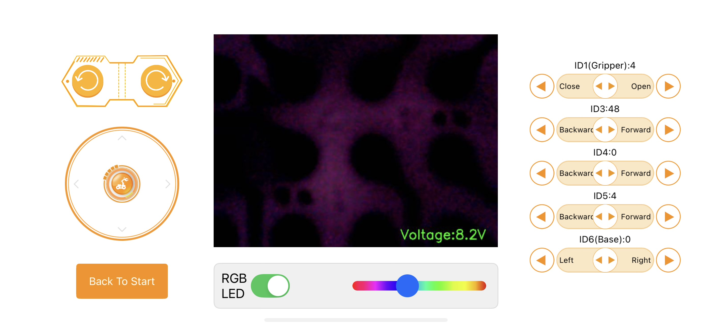
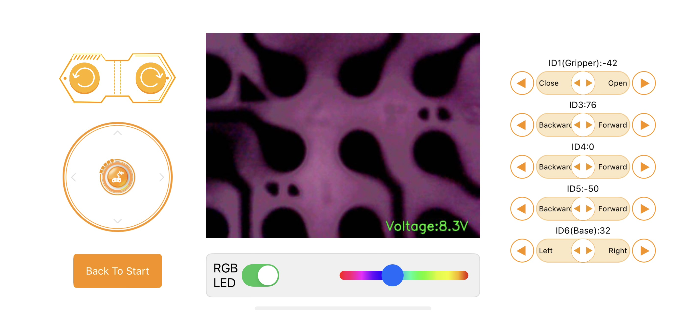
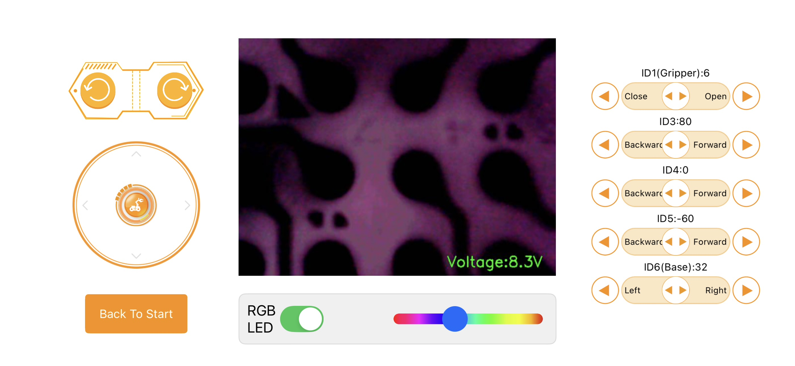
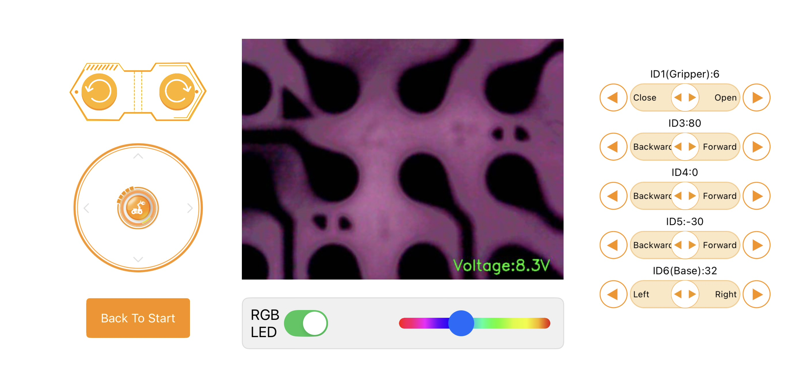
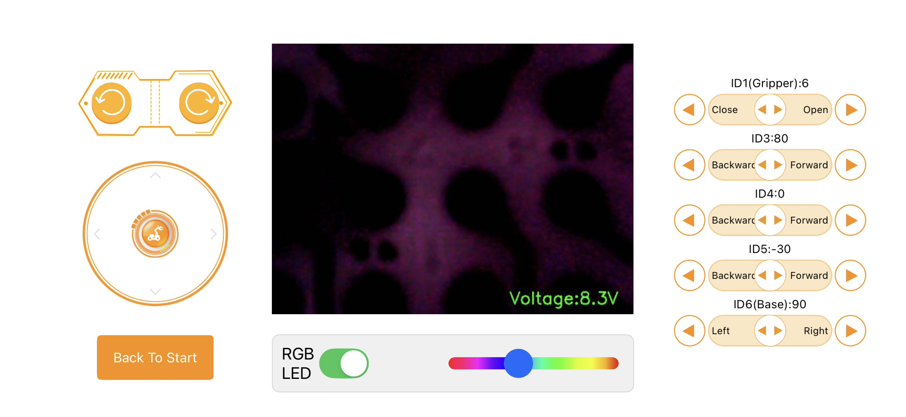
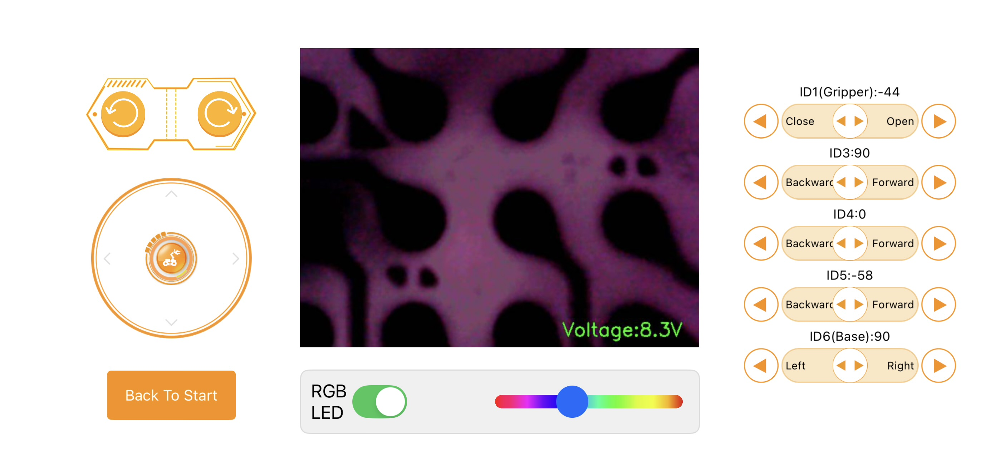

# Etch — sorted photo and position record

**Red cube at the Etch station.** The original record contained 19 supplied images: seven control screenshots and twelve robot photos. Original files outside the repository are unchanged. Some viewing copies were removed for privacy; the remaining copies are stored beside this file.

Screenshot/photo pairings are inferred from filenames, visible poses, and joint changes. Displayed settings are transcribed observations, not measured joint feedback.

**Privacy update:** Pictures containing private messages have been removed. Stage descriptions and numerical settings remain available.

## Ordered positions

| Stage | Control screenshot | Robot photos | ID1 | ID3 | ID4 displayed only | ID5 | ID6 | Voltage |
| --- | --- | --- | ---: | ---: | ---: | ---: | ---: | ---: |
| 1. Base/start reference | IMG_1022.HEIC | IMG_1023.jpg | 4 | 48 | 0 | 4 | 0 | 8.2 V |
| 2. Open approach to red cube | IMG_1024.HEIC | IMG_1025.jpg, IMG_1026.jpg | -42 | 76 | 0 | -50 | 32 | 8.3 V |
| 3. Grip red cube | IMG_1027.HEIC | IMG_1028.jpg, IMG_1029.jpg | 6 | 80 | 0 | -60 | 32 | 8.3 V |
| 4. Lift red cube | IMG_1030.HEIC | IMG_1031.jpg, IMG_1032.jpg | 6 | 80 | 0 | -30 | 32 | 8.3 V |
| 5. Turn held cube toward tray | IMG_1033.HEIC | IMG_1034.jpg | 6 | 80 | 0 | -30 | 90 | 8.3 V |
| 6. Lower held cube over tray | IMG_1035.HEIC | IMG_1036.jpg, IMG_1037.jpg | 6 | 90 | 0 | -58 | 90 | 8.3 V |
| 7. Release red cube in tray | IMG_1038.HEIC | IMG_1039.jpg, IMG_1040.jpg | -44 | 90 | 0 | -58 | 90 | 8.3 V |

## Filename inventory

- [IMG_1022.HEIC](/Users/joshua/Downloads/IMG_1022.HEIC) — stage 1: Base/start reference.
- IMG_1023.jpg — picture removed for privacy; see the stage description and settings.
- [IMG_1024.HEIC](/Users/joshua/Downloads/IMG_1024.HEIC) — stage 2: Open approach to red cube.
- IMG_1025.jpg — picture removed for privacy; see the stage description and settings.
- IMG_1026.jpg — picture removed for privacy; see the stage description and settings.
- [IMG_1027.HEIC](/Users/joshua/Downloads/IMG_1027.HEIC) — stage 3: Grip red cube.
- IMG_1028.jpg — picture removed for privacy; see the stage description and settings.
- IMG_1029.jpg — picture removed for privacy; see the stage description and settings.
- [IMG_1030.HEIC](/Users/joshua/Downloads/IMG_1030.HEIC) — stage 4: Lift red cube.
- IMG_1031.jpg — picture removed for privacy; see the stage description and settings.
- IMG_1032.jpg — picture removed for privacy; see the stage description and settings.
- [IMG_1033.HEIC](/Users/joshua/Downloads/IMG_1033.HEIC) — stage 5: Turn held cube toward tray.
- IMG_1034.jpg — picture removed for privacy; see the stage description and settings.
- [IMG_1035.HEIC](/Users/joshua/Downloads/IMG_1035.HEIC) — stage 6: Lower held cube over tray.
- IMG_1036.jpg — picture removed for privacy; see the stage description and settings.
- IMG_1037.jpg — picture removed for privacy; see the stage description and settings.
- [IMG_1038.HEIC](/Users/joshua/Downloads/IMG_1038.HEIC) — stage 7: Release red cube in tray.
- IMG_1039.jpg — picture removed for privacy; see the stage description and settings.
- IMG_1040.jpg — picture removed for privacy; see the stage description and settings.

## Paired visual evidence

### 01 — Base/start reference

Upright arm with empty gripper; red cube rests at Etch.

*Picture removed for privacy. The pose is described above; recorded servo settings are retained.*

### 02 — Open approach to red cube

Open fingers approach the red cube on the cardboard. External views containing private messages have been removed.

*Picture removed for privacy. The pose is described above; recorded servo settings are retained.*

*Picture removed for privacy. The pose is described above; recorded servo settings are retained.*

### 03 — Grip red cube

Fingers close around the red cube at the surface. ID3 and ID5 also change from the approach setting; this is not only a gripper change.

*Picture removed for privacy. The pose is described above; recorded servo settings are retained.*

*Picture removed for privacy. The pose is described above; recorded servo settings are retained.*

### 04 — Lift red cube

Red cube is visibly suspended above its empty Etch outline.

*Picture removed for privacy. The pose is described above; recorded servo settings are retained.*

*Picture removed for privacy. The pose is described above; recorded servo settings are retained.*

### 05 — Turn held cube toward tray

Red cube remains held while the arm turns toward the tray.

*Picture removed for privacy. The pose is described above; recorded servo settings are retained.*

### 06 — Lower held cube over tray

Red cube is held low over the tray containing green and blue cubes. Exact support/contact is not established from these views.

*Picture removed for privacy. The pose is described above; recorded servo settings are retained.*

*Picture removed for privacy. The pose is described above; recorded servo settings are retained.*

### 07 — Release red cube in tray

Open fingers and red cube resting above the green/blue cubes are visible; 1040 provides a closer view of the stack. No later return pose is supplied.

*Picture removed for privacy. The pose is described above; recorded servo settings are retained.*

*Picture removed for privacy. The pose is described above; recorded servo settings are retained.*

## Record boundaries

- ID4 displays 0 in all seven screenshots. It remains excluded from commands; these records do not authorize sending it to zero.
- Recorded ID3 values are 48, 76, 80, or 90, all at or above the minimum 30. Photos do not validate the full motion paths.
- Exact displayed values are preserved without applying lift trim, inventing durations, or adding a return pose.
- The final photos show red resting on the other cubes in the tray; this records the demonstration and does not define a general stacking routine.
- No executable script or robot configuration was changed, and no robot commands were sent.

Related records: [Deposition](../deposition/README.md) · [Metrology](../metrology/README.md).
