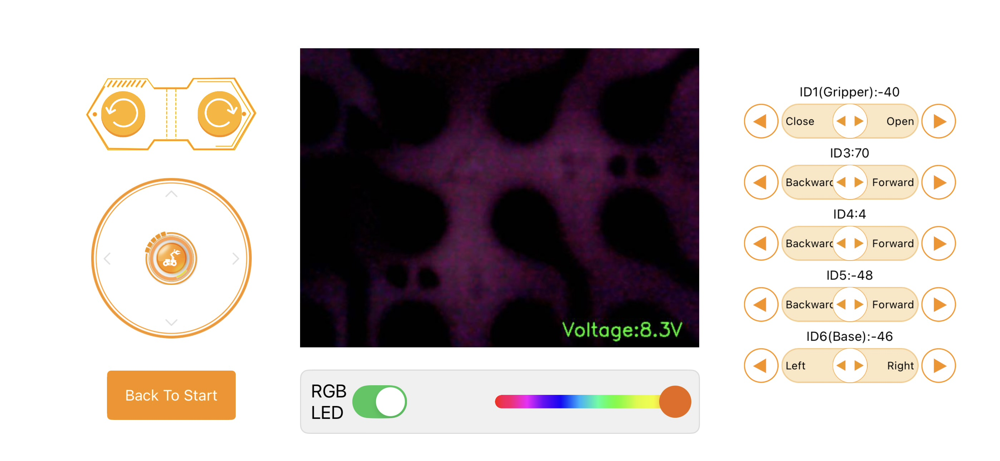
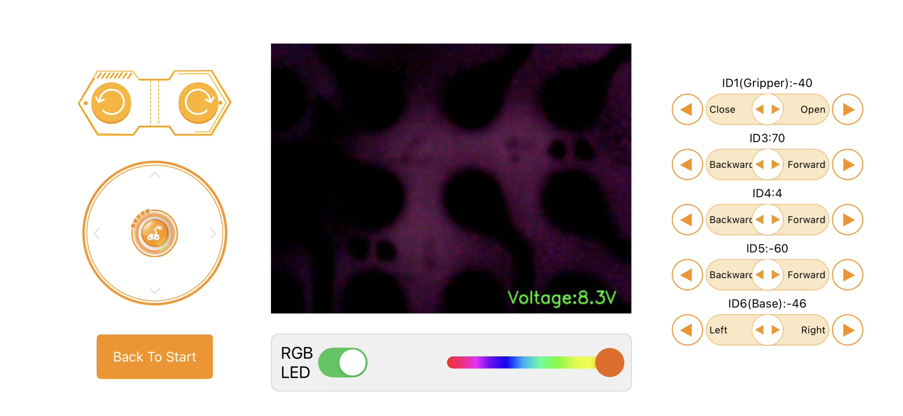
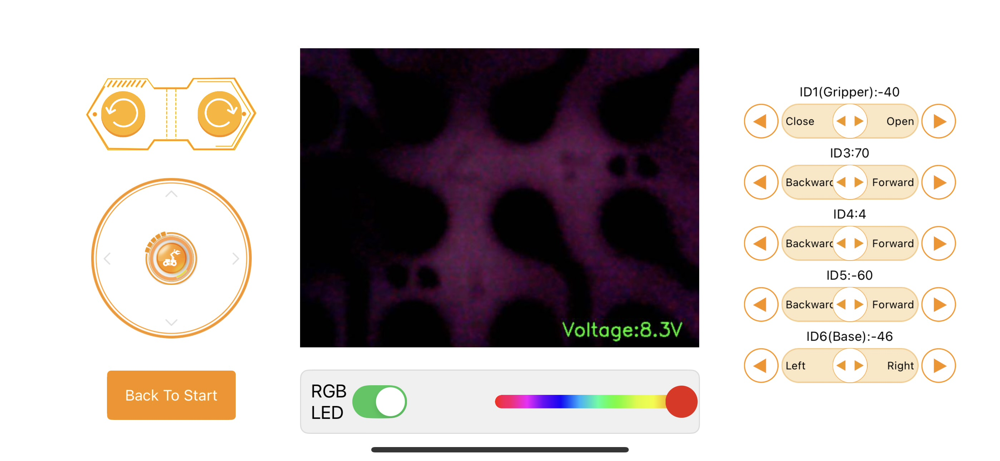
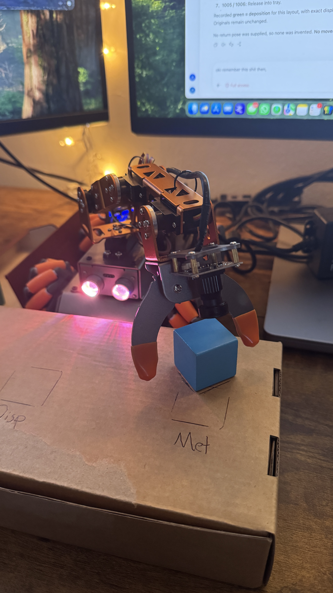
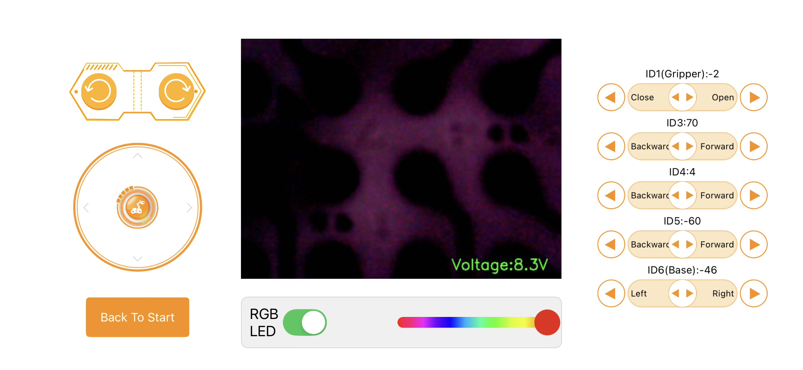
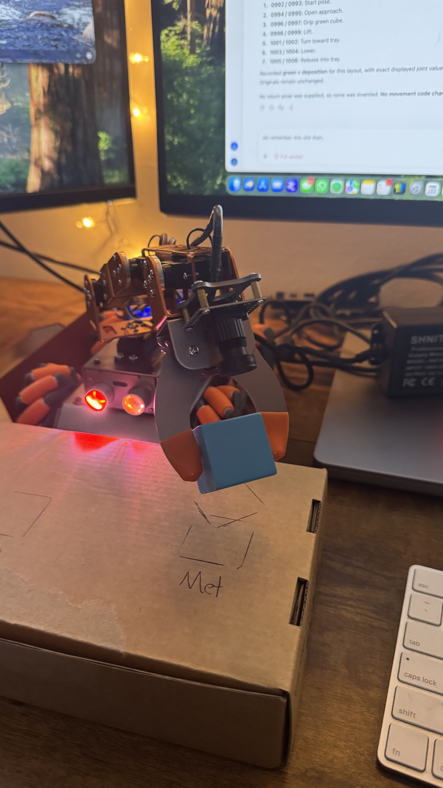
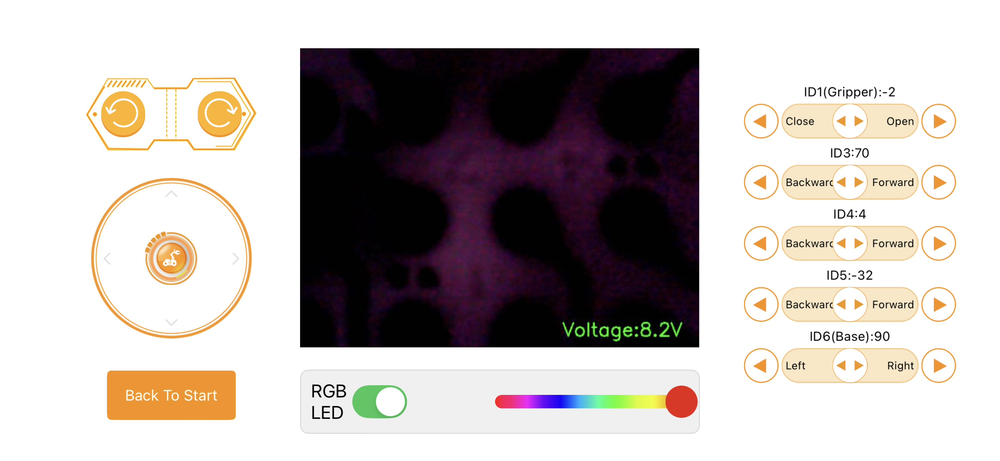
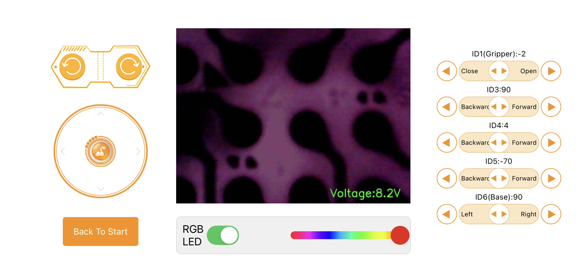
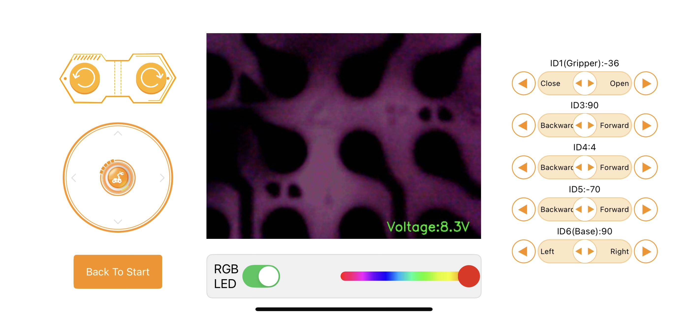

# Metrology — sorted photo and position record

**Blue/cyan cube at the Met station.** Organized in the same format as the deposition record. All 15 supplied files are included: seven control screenshots and eight robot photos. Originals are unchanged; ordered viewing copies are stored beside this file.

Logical order is inferred from the cube position, gripper state, joint changes, and filenames. Screenshot/photo associations are likely matches, not independently synchronized measurements. Missing control values remain missing.

## Ordered positions

| Stage | Control source(s) | Robot photo(s) | ID1 | ID3 | ID4 displayed only | ID5 | ID6 | Voltage |
| --- | --- | --- | ---: | ---: | ---: | ---: | ---: | ---: |
| 1. Start/reference photo | Not supplied/matched | IMG_1007.JPG | — | — | — | — | — | — |
| 2. Open approach above metrology | IMG_1008.HEIC | Not supplied for this exact setting | -40 | 70 | 4 | -48 | -46 | 8.3 V |
| 3. Lower/open at cube | IMG_1009.HEIC, IMG_1011.HEIC | IMG_1010.jpg | -40 | 70 | 4 | -60 | -46 | 8.3 V |
| 4. Grip blue cube | IMG_1012.HEIC | IMG_1013.jpg | -2 | 70 | 4 | -60 | -46 | 8.3 V |
| 5. Raised cube — photo only | Not supplied/matched | IMG_1014.jpg | — | — | — | — | — | — |
| 6. Turn held cube toward tray | IMG_1015.HEIC | IMG_1016.jpg | -2 | 70 | 4 | -32 | 90 | 8.2 V |
| 7. Lower held cube into tray | IMG_1017.HEIC | IMG_1018.jpg, IMG_1019.jpg | -2 | 90 | 4 | -70 | 90 | 8.2 V |
| 8. Release blue cube in tray | IMG_1020.HEIC | IMG_1021.jpg | -36 | 90 | 4 | -70 | 90 | 8.3 V |

## Sequence diagram

```text
Start photo → Open approach → Lower/open → Grip → Lift photo
                                                    ↓
                          Release in tray ← Lower ← Turn to tray
```

## Filename inventory

- [IMG_1007.JPG](/Users/joshua/Downloads/IMG_1007.JPG) — stage 1: Start/reference photo.
- [IMG_1008.HEIC](/Users/joshua/Downloads/IMG_1008.HEIC) — stage 2: Open approach above metrology.
- [IMG_1009.HEIC](/Users/joshua/Downloads/IMG_1009.HEIC) — stage 3: Lower/open at cube.
- [IMG_1010.jpg](/Users/joshua/Downloads/IMG_1010.jpg) — stage 3: Lower/open at cube.
- [IMG_1011.HEIC](/Users/joshua/Downloads/IMG_1011.HEIC) — stage 3: Lower/open at cube.
- [IMG_1012.HEIC](/Users/joshua/Downloads/IMG_1012.HEIC) — stage 4: Grip blue cube.
- [IMG_1013.jpg](/Users/joshua/Downloads/IMG_1013.jpg) — stage 4: Grip blue cube.
- [IMG_1014.jpg](/Users/joshua/Downloads/IMG_1014.jpg) — stage 5: Raised cube — photo only.
- [IMG_1015.HEIC](/Users/joshua/Downloads/IMG_1015.HEIC) — stage 6: Turn held cube toward tray.
- [IMG_1016.jpg](/Users/joshua/Downloads/IMG_1016.jpg) — stage 6: Turn held cube toward tray.
- [IMG_1017.HEIC](/Users/joshua/Downloads/IMG_1017.HEIC) — stage 7: Lower held cube into tray.
- [IMG_1018.jpg](/Users/joshua/Downloads/IMG_1018.jpg) — stage 7: Lower held cube into tray.
- [IMG_1019.jpg](/Users/joshua/Downloads/IMG_1019.jpg) — stage 7: Lower held cube into tray.
- [IMG_1020.HEIC](/Users/joshua/Downloads/IMG_1020.HEIC) — stage 8: Release blue cube in tray.
- [IMG_1021.jpg](/Users/joshua/Downloads/IMG_1021.jpg) — stage 8: Release blue cube in tray.

## Paired visual evidence

### 01 — Start/reference photo

Arm upright, empty gripper; blue cube rests at Met. No joint-setting screenshot confidently matches this start photo.


### 02 — Open approach above metrology

Open gripper command, base -46; ID5 is -48. No separate external photo confidently matches this higher approach setting.



### 03 — Lower/open at cube

Open fingers straddle the blue cube on the Met surface. 1009 and 1011 have identical joint settings; their LED color controls differ.







### 04 — Grip blue cube

Fingers contact opposite sides of blue cube. Photo shows cube tilted and apparently just clear of the surface; exact lift height is not measured.





### 05 — Raised cube — photo only

Blue cube is visibly held higher above the empty Met outline. No separate screenshot provides the exact pre-turn lift setting.


### 06 — Turn held cube toward tray

Blue cube remains held above the tray at left. Compared with pickup, both shoulder ID5 and base ID6 have changed; intermediate timing/order is not shown.




### 07 — Lower held cube into tray

1018 shows cube held low over the tray; 1019 shows it farther down, apparently at the tray surface. Preserve both views; no extra control setting establishes an additional lower pose.




### 08 — Release blue cube in tray

Gripper is open and blue cube is visible in the tray beside the green cube. No subsequent empty-arm return is supplied.




## Important distinctions

- IMG_1007 is the start photo; assigning IMG_1008 controls to it would be unsupported. IMG_1008 is recorded as a separate higher open approach.
- IMG_1009 and IMG_1011 repeat the same joint settings; both are preserved, not counted as separate necessary arm motions.
- IMG_1014 documents the lifted cube, but its exact pre-turn joint values are not supplied. Do not copy ID5=-32/base=90 from the later turn pose into this earlier lift.
- IMG_1018 and IMG_1019 are both retained as views of lowering/placement. There is only one supplied pre-release control record for that stage.
- ID4 displays 4 throughout these screenshots. This is historical observation only; existing ID4 exclusion remains in effect.
- All recorded ID3 values are 70 or 90, above the user-defined minimum 30. This does not validate paths or stability.
- Values are copied exactly, without lift trim, angle substitutions, invented durations, or a generated return path.
- No after-release return-to-start pose is supplied.
- The control screen camera panel is a dark purple patterned image, not an identifiable view of the target cube.
- This is documentation only. No executable script, station configuration, calibration, vendor service, or robot command was changed.
