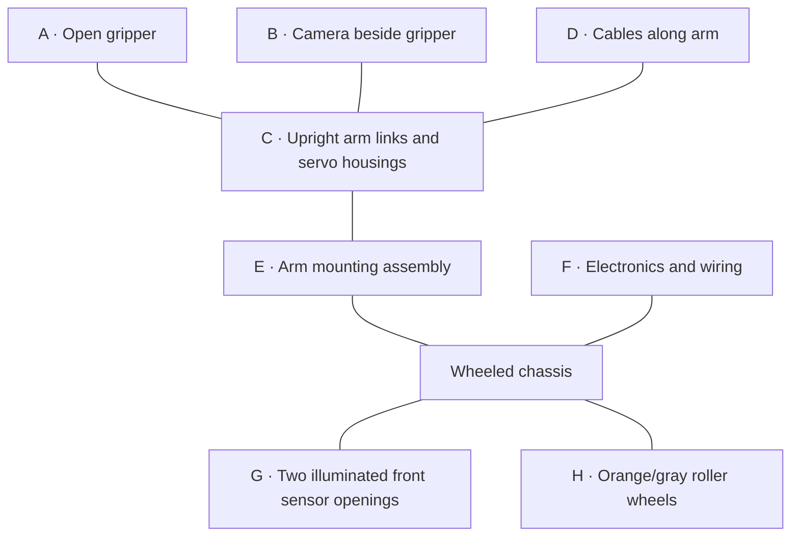

> Historical pose archive. These values are observations, not current execution instructions. See [current pickup guide](../working_pickup.md) for active constraints and targets.

# Raised arm pose — visual record

Recorded October 17, 2026. Reference name: `raised_pose_01`.

The user describes this as “risen all the way.” The images show an upright arm; they do not establish its mechanical maximum height or joint limits. This document records observations only, not a movement instruction.

## App values visible in the screenshot

| App label | Displayed value |
| --- | ---: |
| ID1 (Gripper) | -62 |
| ID3 | -14 |
| ID4 | 2 |
| ID5 | 16 |
| ID6 (Base) | -10 |
| Voltage | 7.0 V |

These are the values displayed by the app, not independently measured physical joint angles. No XYZ position, height, movement duration, or payload mass is shown.

The camera panel is black, with the voltage text visible at its lower right. The image does not establish why the camera panel is black. The RGB LED switch appears enabled and the color selector is in the purple region.

## Photo annotations

The letters below identify visible components, from the top of the arm down to the chassis. They are diagram labels, not servo IDs.

| Label | Visible observation | Image evidence |
| --- | --- | --- |
| A | Two gripper fingers are separated, with orange covers on their ends. No object is visible between them. | Both photos; clearest front view in IMG_0941 |
| B | A camera module with a black cylindrical lens is mounted beside the gripper assembly. | Side view in IMG_0940 |
| C | Orange metal brackets and multiple black servo housings form an upright arm assembly. The links appear approximately vertically aligned. | Both photos |
| D | Cables run along the arm and loop down toward the electronics on the chassis. | Both photos |
| E | The arm's lower mounting assembly is attached to the top of the wheeled chassis. | Both photos |
| F | Exposed electronics, connectors, and wiring are visible behind/beside the arm mounting assembly. | Clearest in IMG_0940 |
| G | Two round, forward-facing sensor openings have blue/purple illumination. | Both photos |
| H | Orange-and-gray roller wheels support the chassis on the desk. | Both photos |

The front-view photo also shows red and blue blocks on a sheet in front of the robot, a partially visible green block at the left edge, and a laptop/cables to the right. No dimensions or station coordinates can be read from these photos. A still image does not establish whether the wheels or arm are moving.

## Small diagram

Schematic of visible arrangement, not to scale. Lines show physical arrangement, not signal flow. The diagram does not assign anatomical joint names to the app's unlabeled IDs.



## Source images

- [App screenshot](</Users/joshua/Downloads/Screenshot 2026-10-17 at 12.06.14 PM.heic>)
- [IMG_0940 — side view](</Users/joshua/Downloads/IMG_0940.jpg>)
- [IMG_0941 — front view](</Users/joshua/Downloads/IMG_0941.jpg>)

### Side view


### Front view


## Scope

This pose has not been added to the motion sequence. No robot command was sent while preparing this record. Repeatable physical clearance and the relationship between this pose and other taught poses have not been established by these images.

## Base pose — added visual record

Reference name: `base_pose_01`. “Base position” is the user's name for this pose; it does not establish a factory home position or an automatically safe return path.

### App values from IMG_0942

| App label | Base pose | Raised pose, for comparison |
| --- | ---: | ---: |
| ID1 (Gripper) | -62 | -62 |
| ID3 | 90 | -14 |
| ID4 | 2 | 2 |
| ID5 | 8 | 16 |
| ID6 (Base) | -10 | -10 |
| Voltage | 7.1 V | 7.0 V |

Only ID3 and ID5 differ between the two displayed joint-setting records. The screenshots do not show the movement used to transition between them, nor measured physical angles.

### Visible annotations

- **Gripper:** fingers are separated, with orange ends projecting approximately horizontally in the photos. No payload is visible between them.
- **Camera:** mounted above the gripper in this pose; the lens faces approximately toward the front of the gripper assembly.
- **Arm:** lower links remain generally upright, while the end assembly is oriented differently from the raised-pose photos.
- **Wiring:** the black camera cable loops behind the end assembly and runs down the arm; smaller wires are visible along the structure.
- **Chassis:** roller wheels, exposed upper electronics, and two illuminated front sensor openings remain visible. Still photographs do not establish motion.
- **Workspace:** green, red, and blue blocks sit on a cardboard surface in front of the robot. A laptop and cables are visible to the right. No distances are shown.
- **Camera panel:** the app shows a dark purple image with large dark shapes and an overlaid `Voltage:7.1V`. The scene content cannot be confidently identified from this screenshot.

### Small base-pose diagram

Schematic only; not to scale and not a motion plan.

```text
                [ Camera ]
                    |
  Open fingers ----[ End assembly ]
                    |
                Upright links
                    |
                Arm mounting
                    |
               [ Chassis ]
               /         \
          Roller wheels / front sensor openings
```

### Source images

- [IMG_0942 — app values](</Users/joshua/Downloads/IMG_0942.HEIC>)
- [IMG_0943 — front/angled view](</Users/joshua/Downloads/IMG_0943.jpg>)
- [IMG_0944 — side/angled view](</Users/joshua/Downloads/IMG_0944.jpg>)


This addition documents the supplied images only. It does not modify the motion sequence or send robot commands.

## Deposition / red-cube pickup pose

Reference name: `deposition_red_pickup_01`. The user identifies the red cube as the deposition item; this supersedes the earlier suggested red = etch assignment for this recorded setup.

### Recorded settings — IMG_0945 with user correction

| App label | Displayed value |
| --- | ---: |
| ID1 (Gripper) | 6 (user-corrected; approximate) |
| ID3 | 64 |
| ID4 | 2 |
| ID5 | -74 |
| ID6 (Base) | -12 |
| Voltage | 7.9 V |

The screenshot displays ID1 = -20; the user corrected the intended pickup/grip setting to approximately 6. The other values are transcribed from the screenshot. These are app command settings, not measured XYZ coordinates or independently verified physical angles. No movement duration is shown. The camera panel shows a purple/dark patterned image rather than an identifiable view of the red cube; voltage is displayed in green.

### Visible annotations

- **Gripper:** orange-covered fingers are positioned on opposite sides of the red cube, appearing to contact its sides in IMG_0947.
- **Red cube:** remains on the cardboard surface inside a drawn outline. The handwritten label beneath it reads `Disp`. The photos do not show the cube lifted clear of the surface or establish gripping force.
- **Arm:** extends forward from the chassis, with the longer links approximately horizontal and the end assembly angled downward toward the cube.
- **Camera:** mounted above the fingers, with its lens angled downward in the side view.
- **Other objects:** a green cube stands to the left in the front view; a blue/cyan cube stands to the right, with `Met` visible beside it in the side view. The user has identified the red cube's station; other station assignments are not inferred solely from cube color.
- **Robot:** chassis remains behind the pickup area. Orange/gray roller wheels, wiring, electronics, and illuminated front sensor openings are visible. Still images do not establish motion.

### Small pickup diagram

Schematic side view; not to scale and not an execution path.

```text
       Forward-reaching arm links -------- [Arm mounting]
                    |                           |
             Camera / gripper               [Chassis]
                  /   \
                 [ RED ]  <- fingers at opposite sides
    _____________[CUBE ]________________
          Cardboard surface, label: Disp
```

### Source images

- [IMG_0945 — app values](</Users/joshua/Downloads/IMG_0945.HEIC>)
- [IMG_0947 — front view at cube](</Users/joshua/Downloads/IMG_0947.jpg>)
- [IMG_0948 — side view at cube](</Users/joshua/Downloads/IMG_0948.jpg>)


This is an additional documented pose, not a replacement of the earlier taught-transfer configuration. No movement scripts were modified or robot commands sent.

## Deposition / red-cube lifted pose

Reference name: `deposition_red_lifted_01`.

### App values from IMG_0949

| App label | Displayed lifted setting | Previous pickup record |
| --- | ---: | ---: |
| ID1 (Gripper) | 6 | Approximately 6, user-corrected |
| ID3 | -14 | 64 |
| ID4 | 80 | 2 |
| ID5 | 12 | -74 |
| ID6 (Base) | -10 | -12 |
| Voltage | 7.8 V | 7.9 V |

These are displayed command settings, not independent joint-position measurements. The camera panel shows a dark purple patterned image; the voltage text is green. No duration, physical height, or path between poses is shown.

### Visible annotations

- **Payload:** the red cube is held between the orange-covered fingers and visibly elevated above the cardboard in both photos. This provides visual evidence of a lifted cube at the photographed instant, not repeated-cycle reliability.
- **Pickup location:** the outlined square labeled `Disp` is empty in the front photo. Green and blue/cyan cubes remain on the cardboard.
- **Arm/end assembly:** the gripper projects forward with the cube; the camera sits above the gripper. Lower orange brackets, black servo housings, and routed cables are visible.
- **Chassis:** remains behind the cardboard work area in these views; still images do not establish wheel movement or absence of movement over the preceding sequence.
- **Monitor:** visible temperature-log rows include readings around 51.8–53.5 C and `OK` statuses. This is a photographed excerpt, not a complete temperature history for this lift.

### ID4 observation requiring follow-up

The user reports that ID4 “wasn't collaborating.” The screenshot displays ID4 = 80, compared with 2 in the pickup record. A displayed setting is not evidence that the physical joint reached it. The photos do not establish whether ID4 failed to move, moved incompletely, or was affected by another cause. Record this pose as photographed with **ID4 response unverified**; do not diagnose a failed servo or claim successful tracking from these images.

### Small lifted-payload diagram

Schematic only; not to scale or a movement instruction.

```text
       [RED CUBE] -- [Gripper + camera] -- Arm assembly
            ↑                                  |
      Visible clearance                    [Chassis]
            |
    [Empty Disp outline]       [Green] [Blue/cyan]
    ______________ Cardboard surface ______________
```

### Source images

- [IMG_0949 — app values](</Users/joshua/Downloads/IMG_0949.HEIC>)
- [IMG_0951 — front view, cube lifted](</Users/joshua/Downloads/IMG_0951.jpg>)
- [IMG_0952 — side/angled view, cube lifted](</Users/joshua/Downloads/IMG_0952.jpg>)


Only documentation was updated. This pose was not added to executable motion configuration; no robot commands were sent.

## Revised sequence with ID4 out of service

Sources: IMG_0955, IMG_0956, IMG_0957, IMG_0958, IMG_0959, and duplicate IMG_0955 2, all HEIC files in the user's Downloads folder. Stage names/order below follow filename order and the user's description; screenshots alone do not establish the actual transitions.

| Inferred stage | ID1 | ID3 | ID5 | ID6 | Displayed ID4 — observation only |
| --- | ---: | ---: | ---: | ---: | ---: |
| Grip — 0955 | 6 | 44 | -82 | 0 | 8 |
| Lift — 0956 | 6 | 44 | -56 | 2 | 8 |
| Destination before release — 0957 | 0 | 90 | -90 | 90 | 6 |
| Released — 0958 | -24 | 90 | -90 | 90 | 6 |
| Released — 0959 | -24 | 90 | -90 | 90 | 8 |

0955 2 repeats the settings in 0955. 0958/0959 have identical usable-joint settings; only displayed ID4 and voltage differ. ID4 is excluded entirely, not commanded to zero. Previously taught poses and IK trajectories cannot be assumed valid with a nonfunctional joint. Omitting commands does not electrically disable a hot servo or guarantee it stops holding torque.

Compared with deposition_red_pickup_01, the new grip changes ID3 from 64 to 44, ID5 from -74 to -82, and ID6 from -12 to 0; ID1 remains 6. The old pickup ID4 was 2; new screenshots show 8, but neither is a verified physical joint angle.

The user intends pickup, transfer before release, release, and return to start. These screenshots capture candidate grip/lift/destination/release settings, but no distinct final return pose or intermediate turn/lower path. The change from grip 6 to destination 0 is transcribed, not silently normalized. New start and return definitions remain unresolved; no additional photographs are required to clarify them in text.

The old nonexecutable ID4-excluded transfer draft and its superseded runner/configuration were removed during final cleanup. Exact historical pose values remain recorded in this document.

## Additional cube — two taught settings

Color/station identity not supplied. File order in the attachment lists IMG_0966 first, but filename order is IMG_0965 then IMG_0966. The user describes pickup then raised; stage association remains to be confirmed rather than inferred from file ordering alone.

| Source | ID1 | ID3 | ID5 | ID6 | Displayed ID4 (excluded) | Voltage |
| --- | ---: | ---: | ---: | ---: | ---: | ---: |
| IMG_0965.HEIC | 6 | 54 | -74 | -32 | 0 | 7.5 V |
| IMG_0966.HEIC | 6 | 54 | -42 | -32 | 0 | 7.5 V |

Only ID5 differs between these two screenshots, by +32 command units. Neither screenshot shows the external arm or payload, so physical lift and clearance cannot be verified visually here. ID4 is omitted from future commands, not sent zero.

Compared with the previous ID4-excluded pickup/lift records (0955/0956), pickup changes ID3 44 to 54, ID5 -82 to -74 and base 0 to -32; lift changes ID3 44 to 54, ID5 -56 to -42 and base 2 to -32, assuming 0965=pickup and 0966=lift. Therefore this is not solely a base-angle substitution. Keep both newly taught settings rather than silently replacing them with the old arm geometry.

Sources: [IMG_0965](</Users/joshua/Downloads/IMG_0965.HEIC>) and [IMG_0966](</Users/joshua/Downloads/IMG_0966.HEIC>). Motion script unchanged; no robot commands sent.

## Final additional cube — approach, pickup, raised

Color/station label not yet supplied. Neutral identifier: `cube_plus32`.

| Source | Inferred stage | ID1 | ID3 | ID5 | ID6 | Displayed ID4 (excluded) |
| --- | --- | ---: | ---: | ---: | ---: | ---: |
| IMG_0967 | Open approach | -44 | 54 | -42 | 30 | 0 |
| IMG_0968 | Grip/pickup | 4 | 52 | -82 | 32 | -10 |
| IMG_0969 | Raised | 4 | 52 | -50 | 32 | -10 |

All three display 7.5 V. Stages are inferred from the user's description and joint/gripper changes; the camera view does not show an identifiable cube or external arm position. The ID4 display changes do not establish physical motion and must not be replayed.

The previous additional cube (`cube_minus32`) uses base -32, pickup ID3=54/ID5=-74, raised ID3=54/ID5=-42 and grip=6. This final cube uses base +32, pickup ID3=52/ID5=-82, raised ID3=52/ID5=-50 and grip=4. Base is the largest difference, but wrist, shoulder, and grip values also differ. Preserve each station's taught settings.

All three station records are now in hardware/station_poses.json. Missing color assignments and an unrecorded open setting for cube_minus32 remain explicit nulls. This configuration has not yet been connected to the motion test, and no robot commands were sent.

## Original-position inventory — reconciliation before further script changes

This table preserves the original screenshot values, without lift trim, borrowed gripper settings, or generated return motions. ID4 values are retained here only as historical observations: they are not to be sent to the robot. The file/source identifiers distinguish records even where station colors were not supplied.

### Start/reference and current three-cube records

| Source | Recorded/inferred role | ID1 | ID3 | ID4 displayed only | ID5 | ID6 |
| --- | --- | ---: | ---: | ---: | ---: | ---: |
| Screenshot 12.06.14 PM | Raised reference | -62 | -14 | 2 | 16 | -10 |
| IMG_0942 | Base/start reference | -62 | 90 | 2 | 8 | -10 |
| IMG_0955 / 0955 2 | Red grip | 6 | 44 | 8 | -82 | 0 |
| IMG_0956 | Red raised | 6 | 44 | 8 | -56 | 2 |
| IMG_0957 | Before release at shared destination | 0 | 90 | 6 | -90 | 90 |
| IMG_0958 | Released at shared destination | -24 | 90 | 6 | -90 | 90 |
| IMG_0959 | Released at shared destination | -24 | 90 | 8 | -90 | 90 |
| IMG_0965 | Second cube, presumed pickup | 6 | 54 | 0 | -74 | -32 |
| IMG_0966 | Second cube, presumed raised | 6 | 54 | 0 | -42 | -32 |
| IMG_0967 | Third cube, presumed open approach | -44 | 54 | 0 | -42 | 30 |
| IMG_0968 | Third cube, presumed pickup | 4 | 52 | -10 | -82 | 32 |
| IMG_0969 | Third cube, presumed raised | 4 | 52 | -10 | -50 | 32 |

Second/third cube colors remain unconfirmed. Role inference is explicit because attachment order differed from filename order; the numbers are direct transcriptions. ID4 display changes do not establish actual physical motion. The third cube has all three source records preserved, including its separate approach at base 30 (not silently replaced with 32).

### Earlier records, retained rather than overwritten

| Source | Earlier role | ID1 | ID3 | ID4 displayed only | ID5 | ID6 |
| --- | --- | ---: | ---: | ---: | ---: | ---: |
| IMG_0933 | Original pickup | 6 | 44 | -52 | -90 | -10 |
| IMG_0934 | Original transfer | 6 | 74 | -22 | -90 | 84 |
| IMG_0935 | Original release | -38 | 74 | -22 | -90 | 84 |
| Screenshot 11.56.23 AM | Original return | -38 | 90 | -22 | 4 | -12 |
| IMG_0945 | Earlier red pickup | -20 in image; corrected by user to about 6 | 64 | 2 | -74 | -12 |
| IMG_0949 | Earlier red lifted | 6 | -14 | 80 | 12 | -10 |

The newer red records supersede earlier red records for the intended ID4-excluded routine; earlier values remain available for traceability.

### Requested sequence versus added behavior

User-requested sequence: base/start -> approach selected cube -> grip -> raise -> move to drop location -> lower -> release -> return empty arm to base/start. Repeat for the next selected cube.

The v3 script added a regrip at the destination and a return of the cube to its source. That was an assistant-added behavior, not a user-taught requirement. It must not be confused with the original records above. The separate +0.5 lift trim was requested later and is not included in this original-value inventory. No motion scripts were changed and no robot commands were sent during this reconciliation.

## Superseding operating constraints — user observations

- ID3 must never be commanded below **30**: user reports backward lean/tipping risk below that setting. The current test's payload validation enforces this minimum. This checks commanded values, not physical feedback or overall stability.
- Earlier recorded ID3=-14 poses are historical only and are now prohibited for replay. Old examples/other vendor programs do not inherit our test's guard.
- ID4 reportedly shifts through displayed/estimated values around 0–10. It remains excluded from our commands. Software exclusion cannot prevent mechanical sag or vendor-service commands; no rigid fixed angle has been established.
- Camera detection cannot establish a stable arm geometry while ID4 moves mechanically. Repeatable autonomous grasping requires a mechanically stable joint or repair and revised calibration.

No robot movement was performed when adding these constraints.
