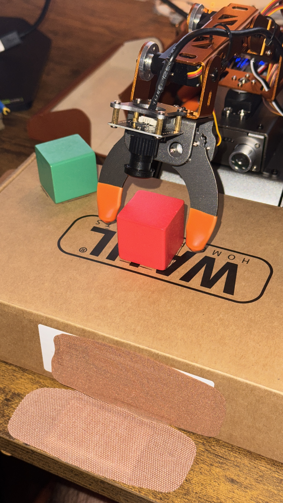
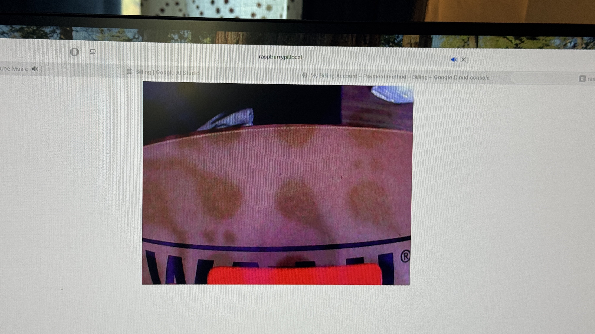

# Hardware finding: arm-mounted camera does not reliably frame the pickup cube

Recorded 2026-10-17 (America/Los_Angeles).

**Finding:** In the tested mounting and taught pickup configuration, the camera does not present enough of the target cube for reliable visual detection. The physical gripper can be positioned around a cube while most of that cube remains outside the camera image. This limits camera-guided presence checks, and leaves automated grip/release verification unproven.

The operator reports that the current camera has not been positioned in a way that reliably detects the pickup cube. This records a limitation of the current hardware arrangement and usable poses, not proof that every mechanically possible camera/arm pose can never see a cube. No exhaustive view sweep or camera intrinsic/extrinsic measurement has been performed.

## Photo evidence

### IMG_1051.jpg — external view of the actual hardware

The red cube is on the box between the open orange gripper tips. A green cube sits farther left. The camera is mounted above the gripper, close to the pickup object. This external view establishes where the cube is relative to the fingers; it is not the onboard camera's field of view. The cube is still supported on the box, so this photo does not demonstrate a successful lift.

### IMG_1053.jpg — photographed display of the onboard feed

The feed is dominated by the box face/printing and room background. Only a narrow red object fragment is visible along the bottom image boundary, consistent with a largely cropped target in this setup. The full cube faces, contact geometry and support relationship are not clearly visible. A model cannot reliably establish cube identity or grip from that strip alone.

This is a photo of a monitor: display/photography artifacts must not all be attributed to camera hardware. The evidence supports a framing/visibility limitation; it does not diagnose a broken sensor, lens fault, exact optical axis, or actual field-of-view angle. Exact synchronization and joint targets for these two photos were not supplied.

Original photos are copied unchanged beside this record. `evidence.json` records filenames, source locations and SHA-256 hashes.

## Separate logged approach trial

The deposition approach-only run is preserved as `approach_run.jsonl` (original run filename `20261018T000857455001Z.jsonl`). It occurred at approximately 17:09 PDT on October 17; the filename/timestamps use UTC on October 18.

- Start command accepted: ID1=4, ID3=60, ID5=-6, ID6=-4.
- Open approach accepted: ID1=-30, ID3=74, ID5=-55.5, ID6=-4; duration 500 ms.
- Camera/API assessment: `status=uncertain`, `pickup_area_visible=false`.
- Model response time: 1.377 seconds.
- The runner stopped at approach, before lowering/gripping. No recovery movement followed.

That trial requested a green deposition target. The new external photo shows a red cube; do not treat them as a synchronized green-cube screenshot/photo pair. The API transport worked, but the image did not support confident target detection. The model's wording about heavy distortion was its interpretation, not an independently confirmed hardware diagnosis.

## Implications for the prototype

1. **Known-pose playback remains useful.** The operator-reported working transfer sequence is separate from camera verification; these findings do not invalidate its demonstrated movements.
2. **Live cube detection is not reliable in the present view.** A taught pose supplies context but cannot prove a cropped/hidden cube exists. Prompting for the bottom edge can help when a recognizable fragment exists, but cannot create missing visual information.
3. **Grip/release verification remains unvalidated.** The camera must show the cube, relevant fingers and support relationship. Missing source pixels or a shifted background do not establish holding or release.
4. **Do not report this as autonomous visual pickup success.** The implemented checkpoint logic correctly stops when observation is uncertain. No meaningful detection-accuracy or grip-success percentage has been established.
5. **ID4 remains excluded and ID3 must remain >=30.** A camera-view experiment cannot assume the damaged joint can be used or the user's movement constraint relaxed.

## What would resolve the limitation

A changed camera mount/tilt/offset or a fixed external camera could provide a usable view. A different observation pose may also help if it respects the physical constraints. These are untested options, not implemented fixes. Validate the view at approach, after lift and over the tray before relying on model assessments at those checkpoints. No camera mount or movement target was changed as part of this documentation.

## Follow-up during the same session

Later trials recognized a partial green cube at the bottom edge after target placement/prompt context were corrected. Moving the pre-grip check from the higher approach to the calibrated open pickup-height pose also addressed the metrology timing problem. The operator subsequently reported the corrected AI run worked. The initial limitation is therefore **restricted framing and unreliable full-cube/grip visibility**, not proof that the camera can never detect a cube. After-lift checking was deliberately weakened to likely color continuity; release became advisory without visible fingers. No accuracy/repeatability percentage was measured.
